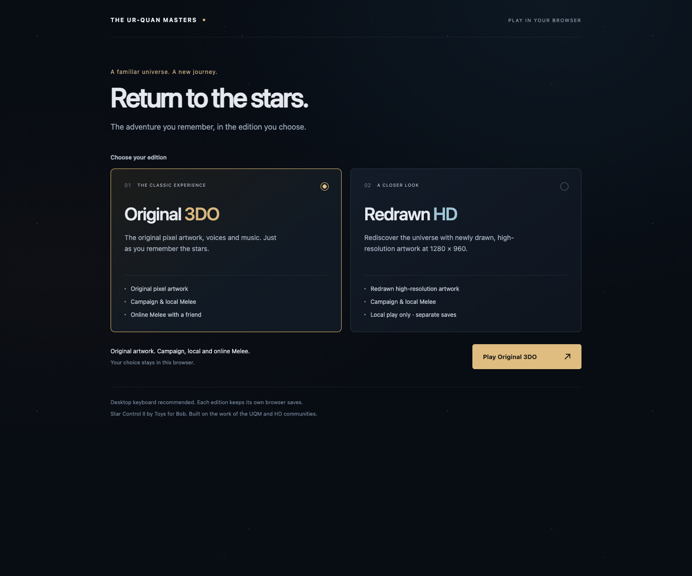
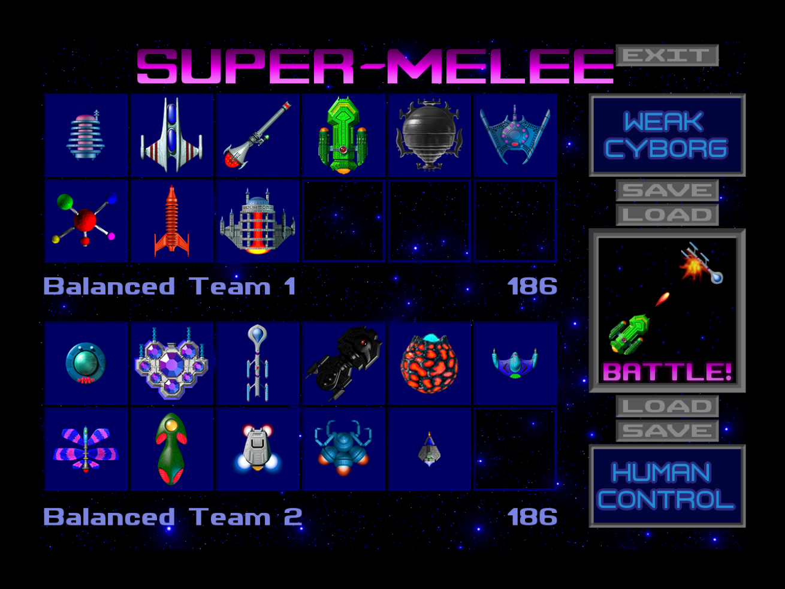

# Original 3DO and Redrawn HD

The edition picker loads one game engine only after an explicit selection.
**Original 3DO** is the existing UQM 0.8.0 WebAssembly port, with its original
artwork, campaign and online Melee. **Redrawn HD** is an independently compiled
[UQM MegaMod 0.8.5](https://github.com/JHGuitarFreak/UQM-MegaMod/tree/0.8.5),
pinned to `1eece12ff9a89d029a5d1f65ead7c75f9ab78acb`, with the matching official
redrawn artwork. Its internal canvas and game surfaces are 1280×960. This is
not a CSS enlargement or a sharpening filter applied to the original sprites.

MegaMod is a different engine with additional options. The launcher chooses
3DO presentation, voices and music, subtitles, normal difficulty, and disables
automatic combat helpers by default. Cheats and extended campaign content are
off by upstream default. It does not claim exact original-game parity. Choose
Original 3DO for the original reference implementation.

HD supports campaign and local Melee. Its build has network play disabled.
HD changes combat coordinate calculations and its save format; it must not
join Original 3DO rooms. The picker routes existing room invitations to Original
3DO. There is no HD room client or relay connection in the HD page.

## Build and preview

Install the pinned Emscripten SDK and Node dependencies as described in the
main README, then run:

```sh
BUILD_OUTPUT="$PWD/.tools/editions-dist" ./scripts/build-editions.sh
npm start -- --dist .tools/editions-dist --port 10001
```

Open `http://127.0.0.1:10001/`. Choose an edition, then click its Launch button
after loading completes. The second click unlocks browser sound. The first
HD content download is about 640 MB; both builds are
intended for desktop browsers. Unselected engines, content and workers are
never loaded by the picker.

The combined package has a small root picker, `original/index.html` and
`hd/index.html`, each with its own relative engine files. The existing
`build-web.sh` still produces a standalone Original 3DO package. The packaging
step adds a return link without changing the Original engine or saved data.
Use an output directory and port separate from an ongoing game session.

HD source and downloaded content stay in ignored `.tools/` directories.
Tracked build patches and content hashes make this build reproducible without
checking hundreds of megabytes of HD media into Git. See
[`hd/content-lock.json`](../hd/content-lock.json) for upstream download URLs,
package hashes and credits. Every package is validated before staging.

## Saved games

The Original database mount remains `/home/web_user/.uqm`. HD uses the separate
mount `/home/web_user/.uqm-hd` and passes that path explicitly to its engine.
They never migrate, copy or overwrite one another's campaign saves. MegaMod
MMV4 saves cannot be loaded by the original engine. Switching editions does
not convert a campaign.

Browser saves belong to the hostname and port as well as the edition. A game
saved on port 9999 is not visible on port 10001. Keep the same URL for ongoing
play. Save through the game menu and wait for the saved status before switching
editions. Clearing site data deletes both editions' browser storage.

The selected edition is remembered separately in localStorage. A blocked
storage API or invalid saved selection falls back to Original 3DO without
preventing a manual choice. An invitation temporarily selects Original without
replacing the user's remembered HD preference.

The HD launcher reapplies native HD resolution and subtitles at startup while
preserving unrelated preferences. An unreadable IndexedDB runs in memory and
does not write back to the database it could not read.

## Attribution

The HD engine preserves upstream GPL notices. The official HD content archive
contains attribution for multiple creators and licenses, including entries
whose license is unspecified in upstream metadata. The project does not assign
one blanket license to that artwork. Original package license and attribution
texts are preserved in the download archives and in the packaged
`hd/content-licenses.txt`. Public redistribution requires a separate review of
those upstream terms. No public release is performed by these scripts.

## Regression checks

`npm test` checks selection, unavailable preference storage, invitation routing,
separate save mounts and navigation while browser writes are queued.

`npm run test:editions` runs both real engines from a combined package. It
checks that the picker fetches no game data, records the native HD canvas,
checks decoded and playing audio, captures the rendered Melee fleet screen,
reloads HD storage and verifies that a genuine Original campaign save remains
byte-identical. Use `UQM_DIST`, `UQM_BROWSER`, `CHROME_BIN` and
`UQM_TEST_OUTPUT` to select the package, browser and evidence location.

`npm run test:hd-campaign` runs a standalone HD package. It loads the genuine
`hd-new-game.uqm` fixture with keyboard input, flies north out of Sol and
requires a rendered, advancing Hyperspace scene with no engine traps.
These browser checks own their fresh browser processes and temporary servers;
they do not connect to the player's existing game session.

The WebAssembly patch includes correctly typed void wrappers for the original
HyperSpace and planet-gravity callbacks. Native builds tolerate those old
function-pointer casts, but WebAssembly traps on their return-type mismatch.
Stack guards remain enabled in the HD build.

`npm run test:hd-stability` keeps a fresh standalone HD engine in the rendered
Melee setup for five minutes, then selects ships and holds thrust/fire for
15 seconds. It requires changing pixels in the actual battle playfield and
fails on runtime errors. `UQM_IDLE_MS` can adjust the dwell; a shorter run is a
navigation check, not equivalent stability coverage. Runtime JavaScript is
not rewritten by this harness.

Both engines use a local backport of Emscripten's
[proxy-context lifetime fix](https://github.com/emscripten-core/emscripten/pull/26582).
The build verifies the exact 3.1.50 runtime source, moves completion/cancellation
signaling inside the existing mutex, and links the resulting local object
before the SDK libraries. The SDK installation and shared library cache are
not modified. Each packaged engine includes `toolchain-fixes.json` with source
hashes and the upstream fix commit.

## Local preview

The chooser loads only the selected game. Use **Shift+Tab**, then release
Shift, to leave the game canvas and focus **Choose edition**. Plain Tab
remains available to the game. Save in-game and wait for the browser-save
status before changing editions.




