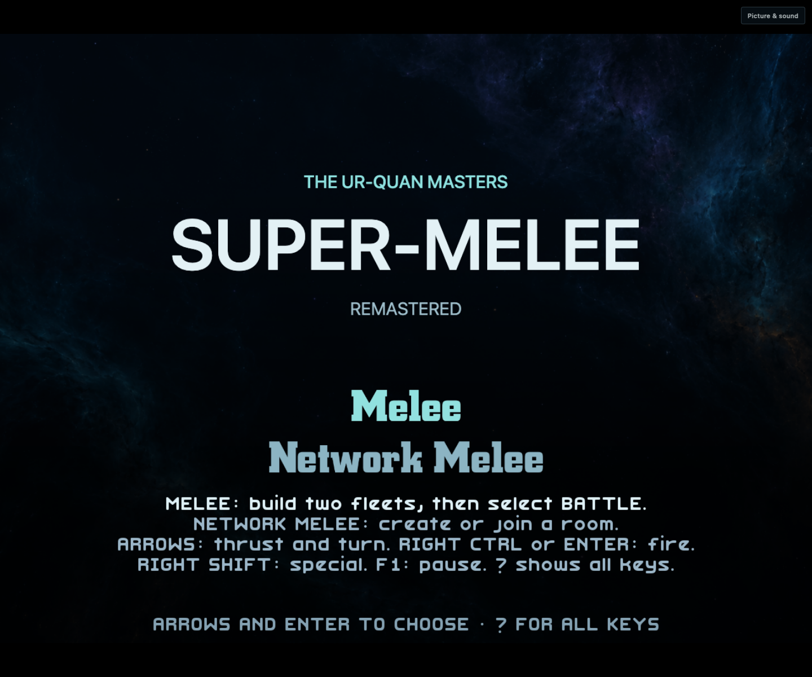
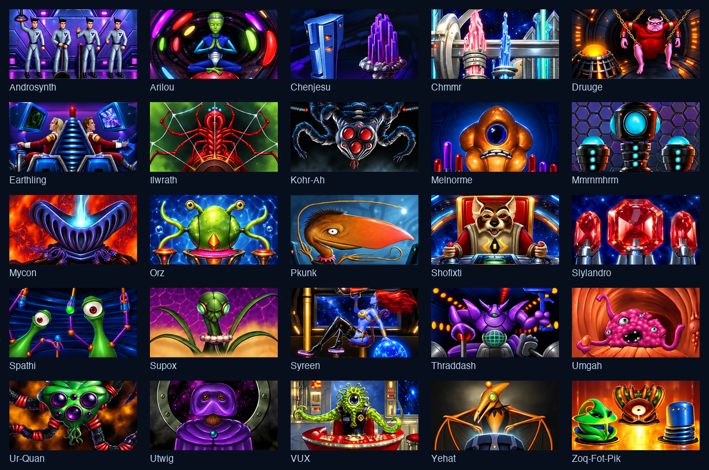
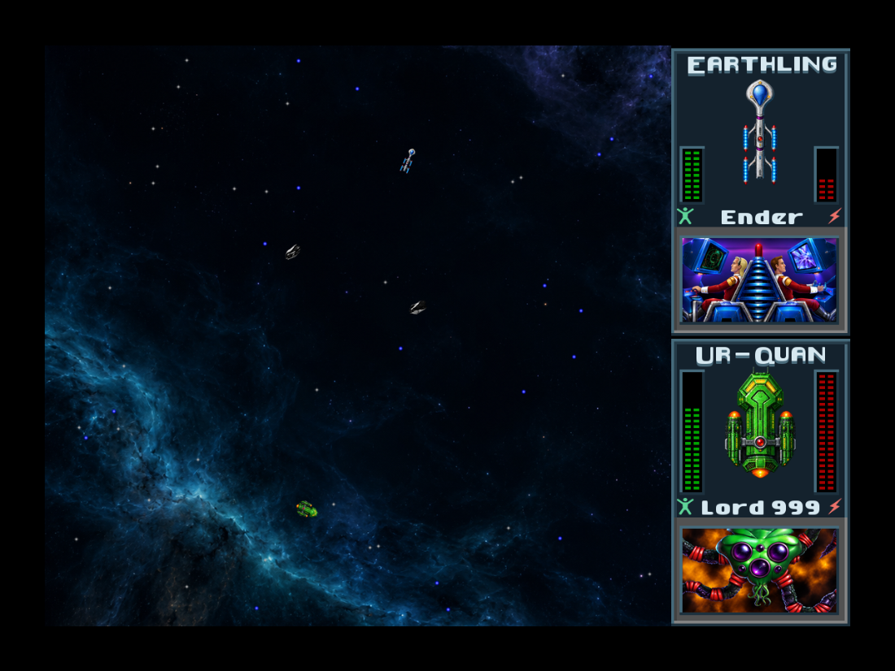

# Melee Remastered

Melee Remastered is a dedicated HD UQM Melee edition with two choices: **Melee**
for local battles and **Network Melee** for online battles. On the site it is
the third card of the picker, at `/melee/` (C engine) and `/melee-rust/` (Rust
engine). It uses the existing HD engines, ships, weapons, special abilities,
gravity, movement, collision images, AI, scoring, fleets and network protocol.
It is not a second combat implementation, and it is not a second build: the
site publishes the HD builds again with the Melee-only page (see
[On the site](#on-the-site-23-october-2026)).

The dedicated entry page, captured after returning from a real local battle:



These are captures of the running native game, not concept images:


The captain extension adds these 25 crew portraits. This sheet shows the actual
compiled neutral frames; live reaction evidence is recorded separately below.



This capture shows the final captain artwork in a real network battle:



## Included

- New ship art for all 25 playable races, plus the Mmrnmhrm Y-Wing, Androsynth
  Blazer and Orz turret: 28 forms, 16 facings and three zoom levels each.
- 1,470 compiled presentation frames: 1,344 hull facings, 75 fleet/HUD icons
  and 51 explosion frames, all fitted to the existing native geometry.
- Redrawn captain and crew portraits for all 25 races: 253 native image
  layers covering all 380 animation slots, including Shofixti's glory device.
  Original identities, control reactions, frame aliases, timing and layer
  ordering remain native. Damage flashes and the death collapse remain native.
- Separate ship and explosion presentation textures, and an authored dark nebula.
- Native fleet/interface/HUD palette and panels with the existing geometry,
  controls, fonts, crew colors and energy colors.
- Two original space-combat scores: *Fleet Mobilization* (fleet setup, 150 BPM)
  and *Hostile Vector* (battle, 168 BPM), with distorted low riffs, driving bass,
  layered war drums, alarm motifs and short tension/rebuild sections.
- A persistent Picture & sound panel, with a live Remastered / Classic HD
  artwork switch and launch-time soundtrack/volume preferences.

The Melee-only launch profile bypasses the original logo, opening movie and
main menu in both engines. Campaign and load-game are not accessible from this
page; its header link goes back to the picker (**Choose game**). Exit fleet setup or finish a disconnected network
session to return to the two mode choices; another match uses the same running
engine. Fleets and preferences persist in browser storage, in their own
folders (`.uqm-melee`, `.uqm-melee-rust`), apart from the HD saves. Picture
changes apply live; soundtrack and volume changes apply after a page reload.

The build still contains the shared UQM engine and content archive. The profile
changes navigation, not combat rules or the contents of that upstream archive.
Generic pages that do not opt into the profile retain their existing flow.

## Melee-only navigation

`hd/wasm/shell.html` is the page of both Redrawn HD and Melee Remastered.
`scripts/package-editions.py` marks the Melee pages with `UQM_VARIANT.meleeOnly`
(and their save folders); with that mark the page opts into `Module.meleeOnly`
before the engine starts, shows **Picture & sound** and uses the Melee texts.
Without it the page is Redrawn HD with its campaign, and it sets
`_UQM_SetMeleeRemastered(0)`: the HD edition's Super-Melee keeps its Classic HD art.
The C profile is reproducible through `hd/patches/0019-melee-only-profile.patch`;
`rust/uqm-engine-hd/src/uqm/restart.rs` and `starcon.rs` implement the same flow.
It initializes the normal game kernel, then runs native `Melee()` directly.
On return it waits at `meleeMenu`, where the web page presents the two choices.
The profile is latched once, so no in-session setting can expose Campaign.

A local choice is consumed once through `takePendingLocalMelee()`. Network
choices retain the established role/room handshake. Native Melee owns teardown,
restores local controls after network sessions, and saves local fleet settings.
`callMain` is invoked once per page load. The shared web controller, help and
storage messages opt into this profile without changing Original edition pages.

## Gameplay preservation

UQM performs pixel collisions against the original images. Replacing ordinary
PNG resources would therefore change combat. This implementation instead keeps
each original `FRAME`, hotspot, dimensions, `NormalImg` and collision mask and
registers an independently owned presentation image. Only the draw path looks
up the new image. The original images are still authoritative for collisions.

The new images must match each original frame's dimensions. Invalid or missing
images fall back to existing artwork. Cloaked Ilwrath remain invisible even
when their replacement artwork is unavailable. Native shield fill colors and
collision silhouettes are retained. Decorative drawing creates no simulation
elements and does not consume the game RNG.

The Rust implementation is `rust/uqm-engine-hd/uqm_melee_presentation.rs`.
The equivalent C change is reproducible through `hd/patches/0010-*`, and
interface/export changes through the following patches. Original content
archives are never modified.

## Build and inspect

```sh
python3 scripts/compile-melee-art.py
python3 scripts/verify-melee-art.py
python3 scripts/compile-melee-captains.py
python3 tests/remastered/captain-assets.py
python3 tests/remastered/captain-renderer-contract.py
bash tests/rust/test-melee-presentation.sh
bash tests/c/test-melee-presentation.sh
bash tests/c/test-melee-only-profile.sh
HD_OFFLINE=1 UQM_CORE=rust HD_BUILD_OUTPUT=.tools/remastered-dist \
  bash scripts/build-hd-web.sh
```

Art compilation is only needed after editing the included source atlases. It
requires Pillow and the pinned HD content cache. `scripts/make-melee-page-art.py`
makes the picker card (`web/editions/melee-card.jpg`) and the start-screen
background (`hd/remastered/art/nebula-start.jpg`) from the same art. Normal builds stage the
already compiled images and two Ogg files; source atlases and editable music
scores are excluded from the native game preload.

Build an independent C engine, then run real two-browser differential tests:

```sh
HD_OFFLINE=1 UQM_CORE=c HD_SOURCE_DIR=.tools/hd-c-source \
  HD_BUILD_OUTPUT=.tools/remastered-c-dist bash scripts/build-hd-web.sh
UQM_MELEE_ONLY=1 UQM_EDITION=hd UQM_REMASTERED=1 UQM_RELAY=rust \
  UQM_DIST=.tools/remastered-dist UQM_PEER_DIST=.tools/remastered-c-dist \
  UQM_TEST_OUTPUT=test-results/remastered-netplay npm run test:browser
UQM_MELEE_ONLY=1 UQM_EDITION=hd UQM_REMASTERED=1 UQM_RELAY=rust \
  UQM_DIST=.tools/remastered-dist UQM_PEER_DIST=.tools/remastered-c-dist \
  UQM_SHIP_SMOKE=all UQM_TEST_OUTPUT=test-results/remastered-all-ships \
  npm run test:browser
UQM_MELEE_ONLY=1 UQM_EDITION=hd UQM_REMASTERED=1 UQM_CAPTAINS=1 UQM_RELAY=rust \
  UQM_DIST=.tools/remastered-dist UQM_PEER_DIST=.tools/remastered-c-dist \
  UQM_SHIP_SMOKE=all UQM_TEST_OUTPUT=test-results/remastered-captains \
  npm run test:browser
```

The separate C source checkout must first be populated online by omitting
`HD_OFFLINE=1`, or copied from an existing checkout at the pinned revision.
The tests verify the exact downloaded Wasm hashes and require different C and
Rust binaries. For the five-minute native idle and battle stability check:

```sh
UQM_MELEE_ONLY=1 UQM_REMASTERED=1 UQM_DIST=.tools/remastered-dist \
  UQM_TEST_OUTPUT=test-results/remastered-hd-stability npm run test:hd-stability
```

`UQM_MELEE_ONLY=1` opens the build's page as the Melee page: the test gives it
the variant that `package-editions.py` writes into `/melee/index.html`
(`tests/browser/melee-page.mjs`). Without it, the same build is the HD page.
`UQM_GUEST_MELEE=1` (without `UQM_MELEE_ONLY`) plays an HD host against a Melee
guest in one HD room.

These tests use normal saved fleets and actual keyboard input. One peer uses
Remastered art and the other Classic HD. They require native replacement draw
activity, verify live switching, and compare the engines' network checksums.
No simulation state or combat outcomes are injected.

Generation provenance is in `hd/remastered/art/provenance.json`; source and
compiled image hashes/geometry are in `hd/remastered/render/manifest.json`.
Captain prompts and provenance are in `hd/remastered/art/captains/`; the
independently audited native inventory lists all original image hashes,
aliases and offsets. `hd/remastered/render/captains-manifest.json` records
every compiled captain layer and its authored source. The compiler crops the
new drawings to native action bounds, preserves original per-pixel alpha,
and shares neutral restoration pixels so incremental animation leaves no trails.
If any layer is missing or malformed, its whole captain window falls back to
Classic HD. A live style change repaints the entire current pose without
advancing or resetting its native animation state. Shofixti's final partial
death frame retains the style of its already displayed portrait, even if a
style change arrives during the detonation frame.
`scripts/prepare-melee-captain-references.py` can reproduce the original
reference sheets and inventory from the pinned archive for future art edits.
Music source, scores and objective audio validation are included alongside the
Ogg files. Browser evidence is written under `test-results/` and is specific to
the exact tested build, rather than being inferred from historical test runs.

## On the site, 23 October 2026

Melee Remastered is the third card of the picker, between Redrawn HD and Cosmo
Clash. The HD builds serve both games:

| Page | Folder | Mark (`UQM_VARIANT`) | Saves |
| --- | --- | --- | --- |
| Redrawn HD | `/hd/`, `/hd-rust/` | none (C), Rust label (Rust) | `.uqm-hd`, `.uqm-hd-rust` |
| Melee Remastered | `/melee/`, `/melee-rust/` | `meleeOnly: true` | `.uqm-melee`, `.uqm-melee-rust` |

- `scripts/package-editions.py` copies each HD build a second time into the
  Melee folder and marks its page; an HD build must have the Melee page files
  (`melee-presentation.js`, `.css`, `melee-nebula.jpg`, `melee-credits.txt`).
- The data bytes are the same, so `deploy/split-data.py` keeps one set of parts
  for the four HD and Melee folders, and the browser keeps one copy (engine
  loader edition `hd`, ETag = the data's SHA-256): a player who has the HD data
  does not download it again for Melee. The HD data is 663 MB (23 MB more
  than before, for the Remastered art and music).
- Network Melee uses the HD rooms and the `hd` room list: HD and Melee
  Remastered players see the same rooms and can play each other.
- Separate save folders: two tabs (HD and Melee) never write over each other's
  IndexedDB files.
- The picker art (`web/editions/melee-card.jpg`) and the start-screen
  background are made from the art of this edition (`make-melee-page-art.py`).
- CI runs the tests of both pages (`build.yml`), the developer's art and
  registry tests, and one mixed room (HD host, Melee guest). The deploy gate
  runs a Melee match and checks that the Melee pages start from the stored
  HD data.

Validation on one computer (Chromium, real C and Rust builds of this branch,
Rust relay):

- 243 JavaScript and server tests; the Worker site test; the native C/Rust
  comparisons of the HD job (patch upgrade, netplay units, exports, Rust core,
  velocity, queues/geometry, bounding boxes, PNG, Lua, solar order, Melee
  profile and presentation registries, captain assets, compiled art).
- Melee page, Rust host and C guest, Remastered against Classic HD art: full
  fleet matches with 575 (normal) and 588 (30-120 ms delay) checksums per
  player, setup departure, return to the two choices, local battle after the
  network session. C host and Rust guest: the local and network re-entry run.
  Eight ships (movement, weapon, special) without a checksum mismatch.
- HD page, Rust host and C guest: 538 and 545 checksums, setup departure,
  return to the main menu. Two sessions from the HD main menu (536, 537). The
  HD campaign loads a save, leaves Sol and flies in Hyperspace.
- One HD room, HD page (C host) against Melee page (Rust guest): 532
  checksums per player; each page returns to its own menu.
- Online UI (test engine), HD and Melee pages: keyboard flows at 1280 x 960
  and 1024 x 768, mouse flow, invitation, reload, lobby error and failure
  screens.

## Melee-only navigation validation, 22 October 2026

The final C and Rust builds passed real-browser verification after the launch
profile, help and native fleet guidance changes:

- Direct local entry, combat, F10 confirmation back to fleet setup, EXIT to the
  two choices, local replay, Network Melee lobby Back, reload and local relaunch.
  Rust remained in fleet setup for 300 seconds; C for 30 seconds. Both then ran
  more than 15 seconds of combat with motion in all 15 sampled comparisons and
  waited 25 seconds at the returned mode choices. No runtime errors occurred.
- Rust host / C guest completed normal and 30–120 ms delayed full fleet matches,
  with 575 and 588 matching checksums per peer, respectively. Setup, selection
  and battle disconnects returned to the mode choices. C host / Rust guest
  also completed a full match with 574 matching checksums per peer.
- Both host engines entered local fleet setup before networking, then played a
  real local battle after the network session, without a peer. Ship selection
  used the actual HD defaults: Enter for player one and Q for player two.
  Native rendering advanced, real inputs moved the playfield, and local fleet
  preferences survived network use and reload.
- Every recorded native transition was `melee` or `meleeMenu`; no opening,
  original main-menu or campaign route appeared. Web UI tests also checked
  keyboard/mouse, Classic artwork and missing-art fallback at 1280×960 and
  640×480, rejecting any drawing of the old title image.
- All 231 JavaScript/server tests passed. The focused native profile cases,
  reproducible patches and Lua propagation audit passed. CI now exercises this
  profile while retaining the Original edition's existing checks.

These network runs used independent Chromium processes on one computer through
its real Rust relay. Exact final build and changed implementation hashes,
screen histories and compact results are in the
[navigation validation record](validation/melee-only-navigation.json).
The tested build artifacts were rehashed after verification.

## Captain and combat-score validation, 22 October 2026

- All 25 crew portraits passed independent image and live-capture review.
  The 253 compiled PNGs preserve original dimensions, per-pixel alpha, source
  hashes and all 380 ANI slots/aliases. Incremental press/release and current-pose
  refresh checks passed. The existing 1,470 ship frames remain valid.
- Real keyboard tests exercised 157 native action phases across all 25 races.
  They rendered 251 reachable unique captain PNGs, with zero residual pixels
  after release and zero pose changes after a held-input style round trip.
  The two remaining PNGs are original dormant states: Druuge's held-special
  frame and Shofixti's safe-lever restoration frame. Both were checked statically.
  Rust/Remastered and C/Classic verified 12,541 and 12,530 checksums respectively
  through the Node relay, without a mismatch.
- That full-25 run used the frozen captain-art build. After the isolated
  Shofixti final-death style guard and soundtrack revision, final release builds
  repeated Human, Mycon and Shofixti in Rust, and Shofixti in C, over the Rust
  relay. Native death row 19, next-ship selection and all tested toggles passed.
  The final-death toggle race also has focused C and Rust unit coverage.
- Final release netplay passed normal play, variable 30–120 ms delay, and setup
  departure through the Rust relay. The first two completed full fleet matches
  and entered rematches, verifying 575 and 592 checksums per peer. Setup,
  selection and battle disconnect recovery and saved fleets after reload passed.
  The final Rust runtime survived 300,000 ms idle and 15.540 seconds of combat,
  with 16 battle captures, motion in all 15 comparisons, and no runtime errors.
- Both new scores decoded and played through native game audio. Exact loop
  samples, true peaks, silence/DC, stereo width and section dynamics passed.
  Battle measures -14.3 LUFS and the fleet menu -15.1 LUFS, both at -1.5 dBTP.
  An independent full render reproduced both PCM hashes and complete Ogg bytes.
- The 222 JavaScript/server tests passed; the four presentation-control tests
  passed again after the final label changes. Both production captain registries
  passed their ownership, fallback, alias, scope and refresh cases. C/Rust builds,
  the all-25 resource-path contract, reproducible patches, and the Lua audit
  (13,443 guarded calls, 110 declarations) passed.

The [captain/release validation record](validation/melee-remastered-captains.json)
separates the full-25 coverage build from the final release builds and records
their exact hashes. Every tested build was rehashed after its tests. The
[art review](validation/captain-art-review.json) and
[audio validation](../hd/remastered/music/validation.json) record their own
scope and limits. Music previews permit human audition; signal tests do not
establish musical taste.

## Ship-remaster baseline validation, 22 October 2026

- All 222 existing and new JavaScript/server tests passed.
- The native registry test passed collision-data isolation, ownership,
  mipmap forwarding, live toggle, UI/campaign scope and missing/malformed
  Ilwrath-art cases. The art verifier checked every compiled frame against
  the immutable pinned archive.
- Both the full Rust engine and the independent C engine compiled. The Lua
  propagation audit passed 13,441 guarded calls and 110 declarations.
- Three real-browser netplay scenarios passed with Rust/Remastered against
  C/Classic HD over the Rust relay: normal play, variable 30–120 ms relay
  delay, and setup departure. Normal and delayed play each completed a full
  fleet match and entered a rematch. Selection, live-battle and setup
  disconnect recovery and saved-fleet persistence after reload passed.
  Match completion verified 578 and 589 simulation checksums per peer,
  respectively, with no mismatch.
- The final native build survived 300,000 ms idle followed by 15.574 seconds
  of combat input: 16 recognized battle frames, motion in all 15 comparisons,
  no runtime or browser error. Final images confirm bright crew/battery
  symbols with unchanged gauge-cell colors.
- All 25 playable hulls passed real keyboard movement, weapon and special
  input with different artwork on the two peers. The run verified 5,381 Rust
  and 5,383 C checksums with no mismatch. Shofixti detonation and native
  next-ship selection were explicitly exercised. Visual review confirmed
  Androsynth/Mmrnmhrm transformations, Ilwrath invisibility, Orz's turret,
  Utwig's filled shield and Thraddash's original fire trail.
- Both Ogg tracks decoded and passed clipping, silence, loop-seam and stereo
  checks; an independent menu-track render reproduced the same bytes.
  The native game loaded the new scores and produced non-silent audio.

Exact build hashes and per-scenario results are in
[the compact validation record](validation/melee-remastered.json). Both output
directories were rehashed after the full run and matched its starting bytes.

These browser runs use two independent Chromium processes on one computer.
They do not establish performance on every device or validate a two-computer
internet session. Audio validation is technical; subjective listening and
commercial-art quality comparisons remain human judgments.
At the furthest native zoom, VUX's dark blue hull can blend into blue nebula
clouds; it is present and intact, but this remains a visual-legibility note
for playtesting. Individual post-input screenshots do not capture every
transient special-effect frame.
