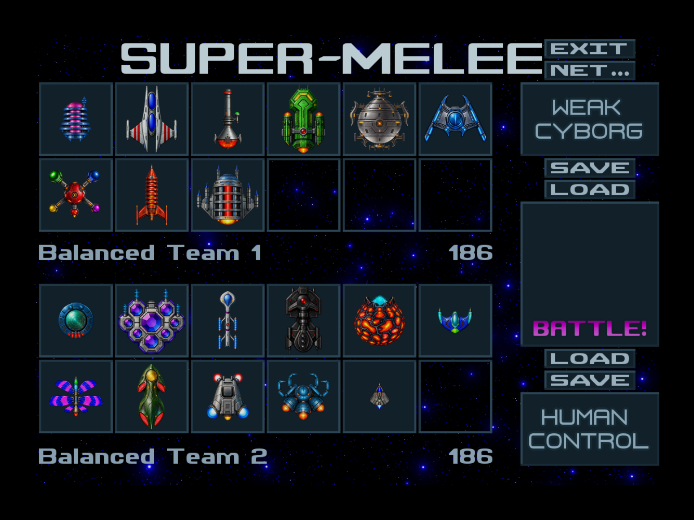
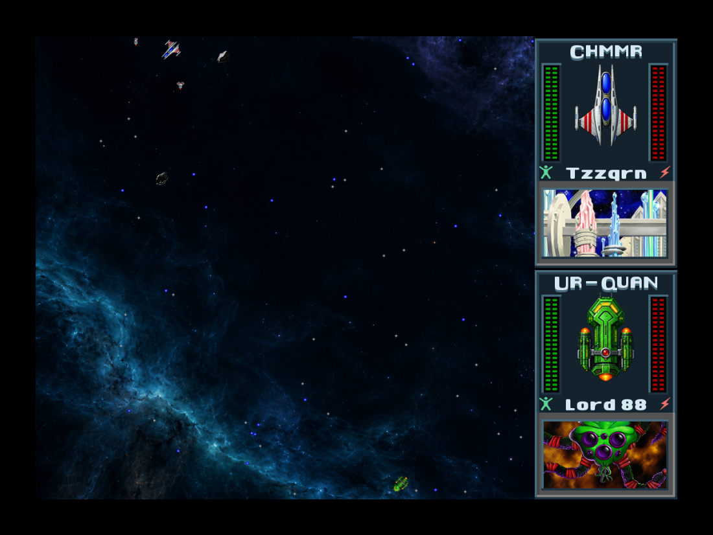

# Melee Remastered

This branch upgrades the real HD UQM Melee presentation. It uses the existing
Rust engine, ships, weapons, special abilities, gravity, movement, collision
images, AI, scoring, fleets and network protocol. It is not a second combat
implementation.

These are captures of the running native game, not concept images:





## Included

- New ship art for all 25 playable races, plus the Mmrnmhrm Y-Wing, Androsynth
  Blazer and Orz turret: 28 forms, 16 facings and three zoom levels each.
- 1,470 compiled presentation frames: 1,344 hull facings, 75 fleet/HUD icons
  and 51 explosion frames, all fitted to the existing native geometry.
- Separate ship and explosion presentation textures, and an authored dark nebula.
- Native fleet/interface/HUD palette and panels with the existing geometry,
  controls, fonts, crew colors and energy colors.
- Two original arranged electronic scores: *Constellation Assembly* (fleet
  setup, 144 BPM) and *Redshift Intercept* (battle, 160 BPM).
- A persistent Picture & sound panel, with a live Remastered / Classic HD
  artwork switch and launch-time soundtrack/volume preferences.

The chosen battle soundtrack also applies to campaign battles because UQM uses
the same `music.battle` resource. The new ship/background rendering and interface
palette are restricted to Melee. Existing projectiles, planets, voices and
captain portraits remain their existing HD resources.

## Gameplay preservation

UQM performs pixel collisions against the original images. Replacing ordinary
PNG resources would therefore change combat. This implementation instead keeps
each original `FRAME`, hotspot, dimensions, `NormalImg` and collision mask and
registers an independently owned presentation image. Only the draw path looks
up the new image. The original images are still authoritative for collisions.

The new images must match each original frame's dimensions. Invalid or missing
images fall back to existing artwork. Cloaked Ilwrath remain invisible even
when their replacement artwork is unavailable. Native shield fill colors and
collision silhouettes are retained. Decorative drawing creates no simulation
elements and does not consume the game RNG.

The Rust implementation is `rust/uqm-engine-hd/uqm_melee_presentation.rs`.
The equivalent C change is reproducible through `hd/patches/0010-*`, and
interface/export changes through the following patches. Original content
archives are never modified.

## Build and inspect

```sh
python3 scripts/compile-melee-art.py
python3 scripts/verify-melee-art.py
bash tests/rust/test-melee-presentation.sh
HD_OFFLINE=1 UQM_CORE=rust HD_BUILD_OUTPUT=.tools/remastered-dist \
  bash scripts/build-hd-web.sh
```

Art compilation is only needed after editing the included source atlases. It
requires Pillow and the pinned HD content cache. Normal builds stage the
already compiled images and two Ogg files; source atlases and editable music
scores are excluded from the native game preload.

Build an independent C engine, then run real two-browser differential tests:

```sh
HD_OFFLINE=1 UQM_CORE=c HD_SOURCE_DIR=.tools/hd-c-source \
  HD_BUILD_OUTPUT=.tools/remastered-c-dist bash scripts/build-hd-web.sh
UQM_EDITION=hd UQM_REMASTERED=1 UQM_RELAY=rust \
  UQM_DIST=.tools/remastered-dist UQM_PEER_DIST=.tools/remastered-c-dist \
  UQM_TEST_OUTPUT=test-results/remastered-netplay npm run test:browser
UQM_EDITION=hd UQM_REMASTERED=1 UQM_RELAY=rust \
  UQM_DIST=.tools/remastered-dist UQM_PEER_DIST=.tools/remastered-c-dist \
  UQM_SHIP_SMOKE=all UQM_TEST_OUTPUT=test-results/remastered-all-ships \
  npm run test:browser
```

The separate C source checkout must first be populated online by omitting
`HD_OFFLINE=1`, or copied from an existing checkout at the pinned revision.
The tests verify the exact downloaded Wasm hashes and require different C and
Rust binaries. For the five-minute native idle and battle stability check:

```sh
UQM_REMASTERED=1 UQM_DIST=.tools/remastered-dist \
  UQM_TEST_OUTPUT=test-results/remastered-hd-stability npm run test:hd-stability
```

These tests use normal saved fleets and actual keyboard input. One peer uses
Remastered art and the other Classic HD. They require native replacement draw
activity, verify live switching, and compare the engines' network checksums.
No simulation state or combat outcomes are injected.

Generation provenance is in `hd/remastered/art/provenance.json`; source and
compiled image hashes/geometry are in `hd/remastered/render/manifest.json`.
Music source, scores and objective audio validation are included alongside the
Ogg files. Browser evidence is written under `test-results/` and is specific to
the exact tested build, rather than being inferred from historical test runs.

## Validation of the final build, 22 October 2026

- All 222 existing and new JavaScript/server tests passed.
- The native registry test passed collision-data isolation, ownership,
  mipmap forwarding, live toggle, UI/campaign scope and missing/malformed
  Ilwrath-art cases. The art verifier checked every compiled frame against
  the immutable pinned archive.
- Both the full Rust engine and the independent C engine compiled. The Lua
  propagation audit passed 13,441 guarded calls and 110 declarations.
- Three real-browser netplay scenarios passed with Rust/Remastered against
  C/Classic HD over the Rust relay: normal play, variable 30–120 ms relay
  delay, and setup departure. Normal and delayed play each completed a full
  fleet match and entered a rematch. Selection, live-battle and setup
  disconnect recovery and saved-fleet persistence after reload passed.
  Match completion verified 578 and 589 simulation checksums per peer,
  respectively, with no mismatch.
- The final native build survived 300,000 ms idle followed by 15.574 seconds
  of combat input: 16 recognized battle frames, motion in all 15 comparisons,
  no runtime or browser error. Final images confirm bright crew/battery
  symbols with unchanged gauge-cell colors.
- All 25 playable hulls passed real keyboard movement, weapon and special
  input with different artwork on the two peers. The run verified 5,381 Rust
  and 5,383 C checksums with no mismatch. Shofixti detonation and native
  next-ship selection were explicitly exercised. Visual review confirmed
  Androsynth/Mmrnmhrm transformations, Ilwrath invisibility, Orz's turret,
  Utwig's filled shield and Thraddash's original fire trail.
- Both Ogg tracks decoded and passed clipping, silence, loop-seam and stereo
  checks; an independent menu-track render reproduced the same bytes.
  The native game loaded the new scores and produced non-silent audio.

Exact build hashes and per-scenario results are in
[the compact validation record](validation/melee-remastered.json). Both output
directories were rehashed after the full run and matched its starting bytes.

These browser runs use two independent Chromium processes on one computer.
They do not establish performance on every device or validate a two-computer
internet session. Audio validation is technical; subjective listening and
commercial-art quality comparisons remain human judgments.
At the furthest native zoom, VUX's dark blue hull can blend into blue nebula
clouds; it is present and intact, but this remains a visual-legibility note
for playtesting. Individual post-input screenshots do not capture every
transient special-effect frame.
