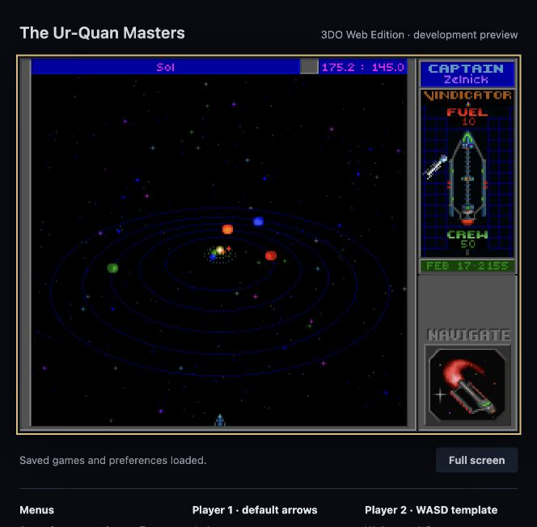
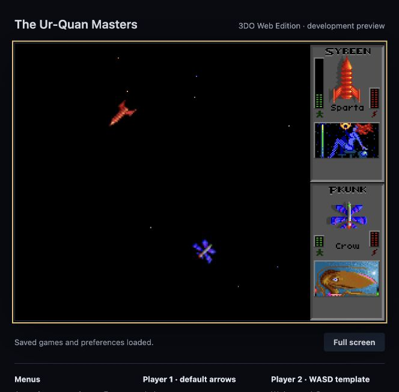

# Local validation — 2026-10-18

Environment: macOS arm64, Emscripten 3.1.50, SDL2 2.24.2 from the Emscripten
port cache. Browser: Codex in-app browser, served from `http://127.0.0.1:9999`.
The browser engine/version was not separately recorded. Debug build with
OpenAL, pthreads and Asyncify. This is an initial desktop browser smoke test.

## Passed

- Compile the original C game and package the Wasm, JavaScript, worker, complete
  content bundle and license file. The initial content bundle was 147,715,790 bytes; the local build with
  installed videos is now 298,763,132 bytes.
- HTTP 200 for the launcher and Wasm, `application/wasm` MIME type and both
  required cross-origin isolation headers.
- Browser loading completes, saved-data initialization finishes and the
  explicit Launch game action starts the engine without a captured console error.
- Original title and main menu render; keyboard input selects menu entries.
- Start the campaign, skip the interim PC intro and render the Sol system.
- Save a new campaign to previously empty slot 00, named `web`. Wait for the
  browser storage completion message, reload the entire page, select Load Game,
  see the same slot/name and restore the Sol game state. The test save remains
  on this browser origin; no pre-existing slot was replaced.
- Enter Super Melee, render both fleets and start local combat against the AI.
  Observe Syreen versus Zoq-Fot-Pik, return to ship selection after destruction,
  select a Pkunk and render a second combat. This verifies startup and transitions,
  not combat balance, frame accuracy or all ship abilities.
- Quit from the original menu, skip the credits through its confirmation,
  and display the browser launcher message that the game closed normally.
- Seven storage regression tests pass: startup success, asynchronous/synchronous
  failures, serialized/coalesced writes, repeated failures and recovery,
  console warning deduplication and a failing UI callback.
- Shell syntax, Python server syntax, package presence/Wasm signature and
  `git diff --check` pass.

## Evidence

## Still unverified

- Exact 3DO parity, all ships and the full campaign; see the
  [compatibility checklist](3do-compatibility.md).
- Audible output quality and latency, speech synchronization and complete ending
  playback. Opening/ship video smoke checks are recorded below; an audible
  comparison was not performed.
- Firefox, Safari, standalone Chrome, mobile browsers, gamepads, two humans on
  one keyboard, full-screen transitions and background-tab behavior.
- Browser-storage quota failure in a real browser (covered with unit harnesses),
  long-running stability and performance/latency measurements.
- Docker build; the local native SDK build is the validated path.
- Online multiplayer and public hosting are future milestones.

## Optional video activation update

The launcher detects all 134 required movie/audio files before engine startup.
Four additional regression tests cover metadata-only content, a complete set
derived from the actual resource map, each individually missing file, and
empty files/directories. The later local installation includes the original movie pack; details follow.

## Local original movie pack — 2026-10-18

- Downloaded the MegaMod 3DO Video Pack to the ignored local cache and checked
  ZIP CRC integrity and SHA-256 (see [media source record](3do-videos.md)).
- Installed 134 required media files, including intro, ending and all 25 ship
  presentations; retained the existing engine resource map.
- Structural validation passed for all 27 clips and 9,209 frames, including
  header dimensions, bounded frame offsets and sections, DUK audio headers,
  decoder scratch-buffer limits and 26 supported AIFF PCM tracks.
- Rebuilt the browser package successfully. The real browser detects the
  complete pack and reports that original videos are enabled.

This does not establish full campaign completion or audible synchronization.

- Original 3DO intro renders changing animated frames in the browser, including
  the opening spacecraft sequence. No browser warnings/errors captured during
  this smoke check. A local screenshot is retained in the ignored media cache.

- Super Melee ship-video test: open the fleet editor with Esc, open its ship
  picker with Enter, then press Alt. The original Androsynth movie renders
  correctly; Esc returns to the picker. No console warning/error captured.
- The ending and the other 24 ship movies are installed and passed structural
  checks; their full playback has not been individually observed.

## Dialogue subtitle fix — 2026-10-18

The launcher previously passed `--nosubtitles`, suppressing spoken dialogue
text even when the saved preference requested it. A positive `--subtitles`
startup flag now enables dialogue text and takes precedence over an older
disabled preference. The existing disabling flag remains available.

- WebAssembly rebuild and `git diff --check` passed.
- In a separate browser session, the rebuilt launcher starts successfully and
  Setup → PC/3do Compatibility Options shows Subtitles: Enabled.
- No browser warning/error captured. The test tab was closed without leaving
  Setup, avoiding a saved-preference write from the test.
- The user's active campaign was not refreshed or modified. They must save
  before reloading to use the updated launch setting.
