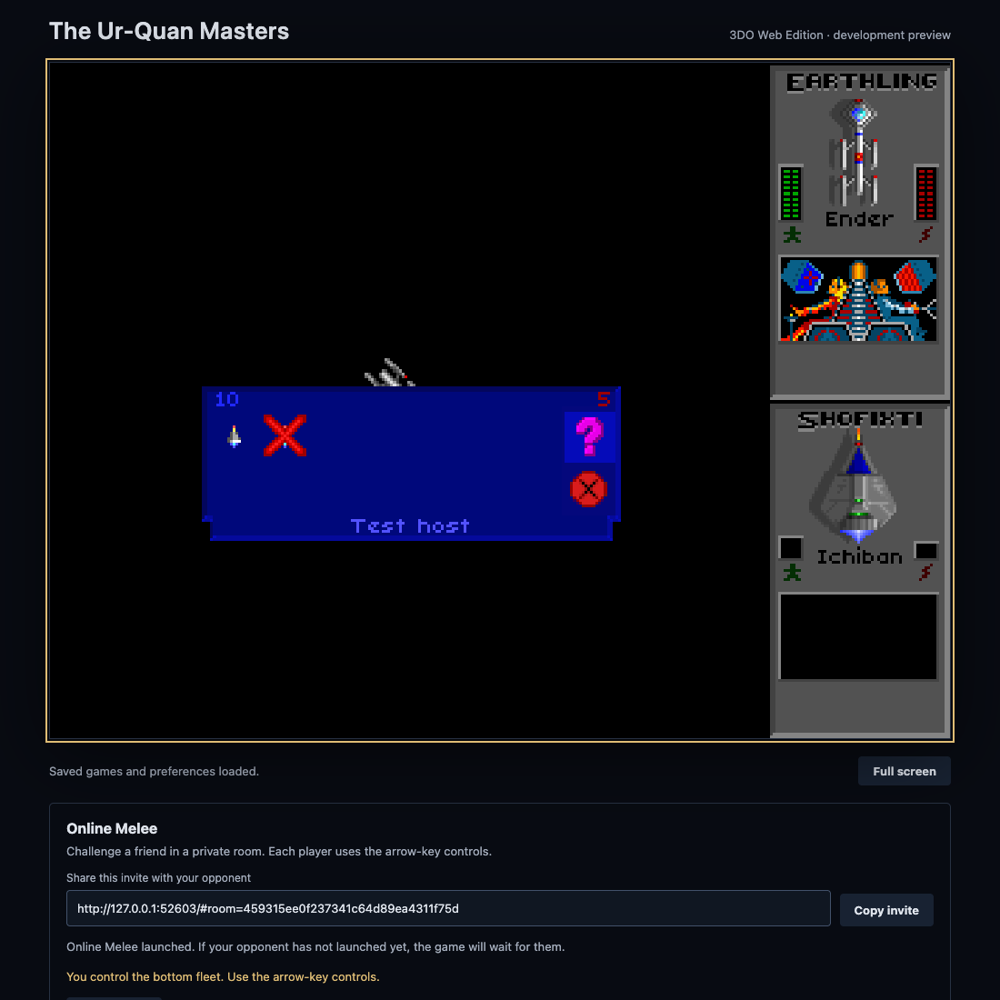
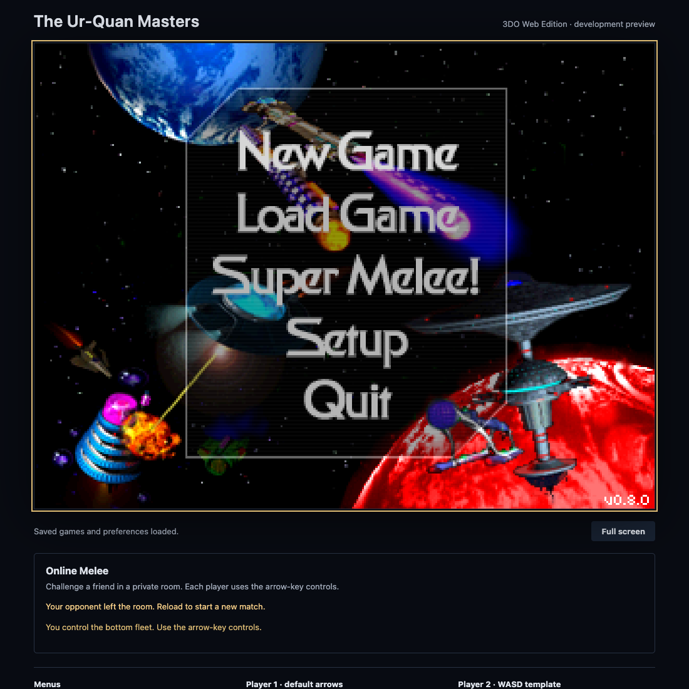
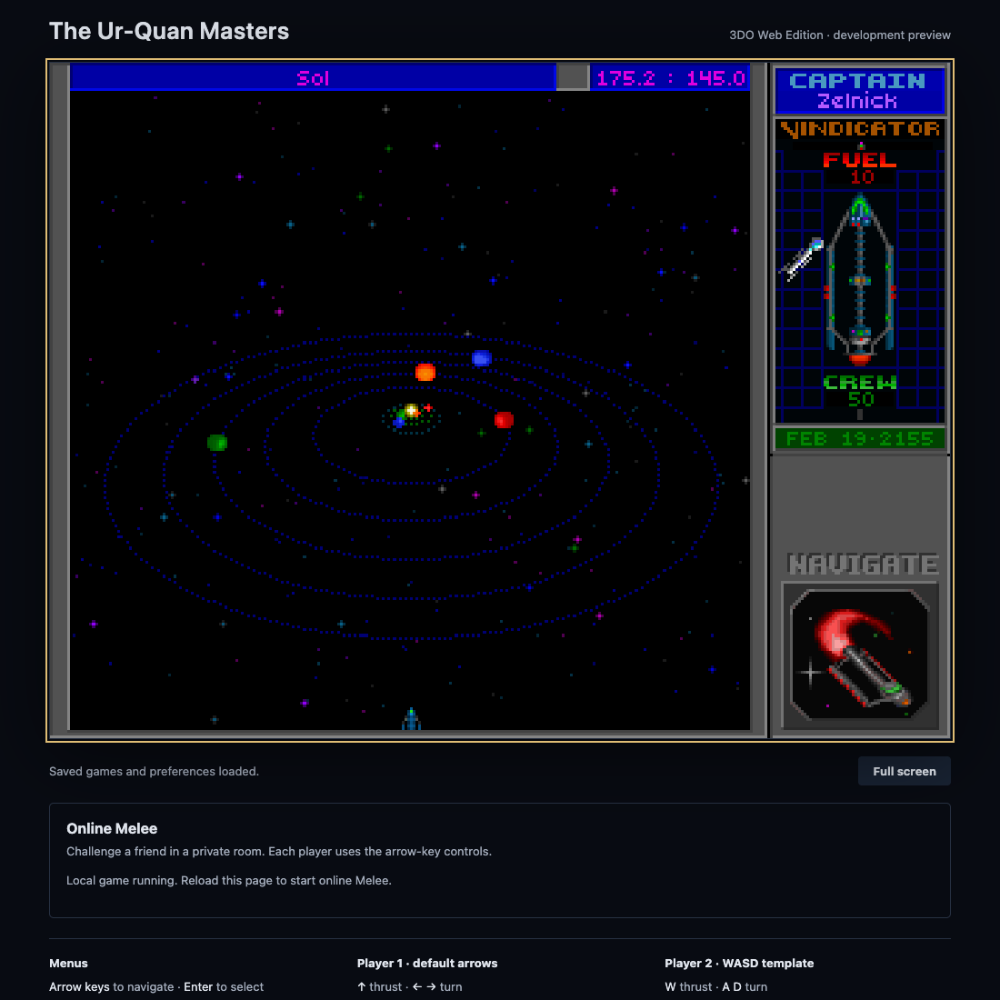
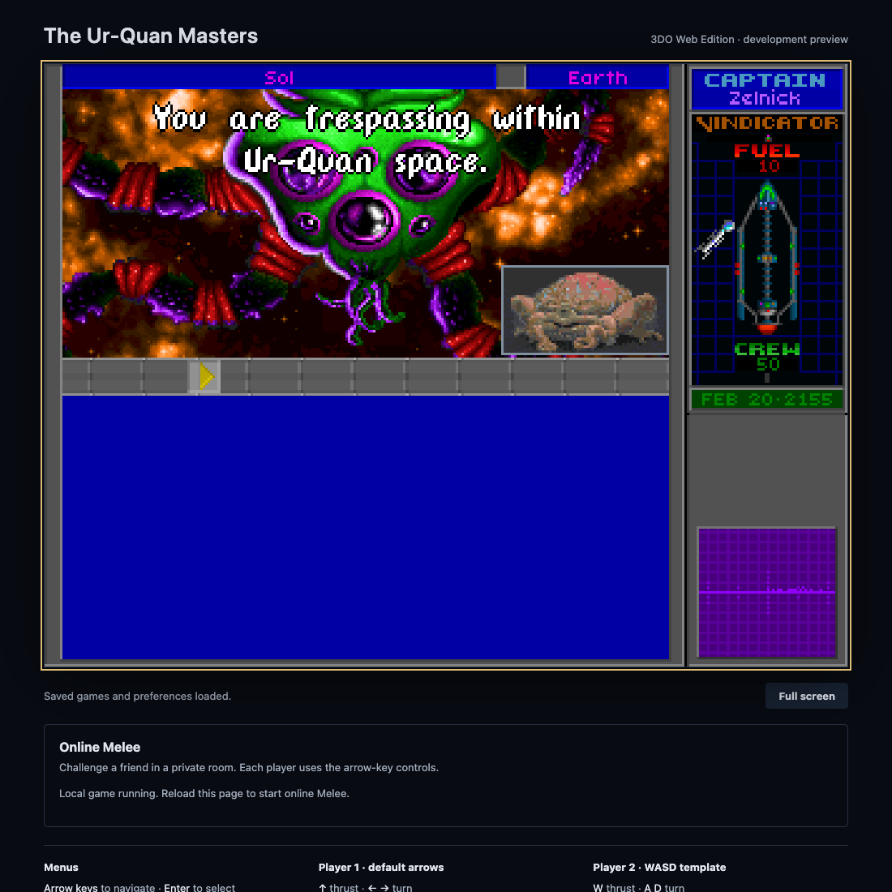
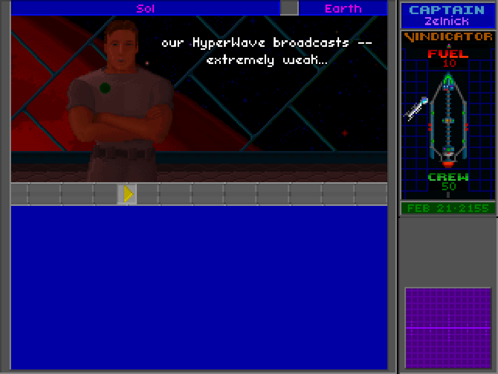

# Local validation — 2026-10-18

This is a dated record of the first local checks (18 to 20 October 2026),
before the site went live. Words such as "private alpha", "not deployed" and
"unverified" describe that time. For the current state, see the
[README](../README.md); CI now runs these checks on every change.

Environment: macOS arm64, Emscripten 3.1.50, SDL2 2.24.2 from the Emscripten
port cache. Browser: an in-app Chromium browser, served from `http://127.0.0.1:9999`.
The browser engine/version was not separately recorded. Debug build with
OpenAL, pthreads and Asyncify. This is an initial desktop browser smoke test.

## Passed

- Compile the original C game and package the Wasm, JavaScript, worker, complete
  content bundle and license file. The initial content bundle was 147,715,790 bytes; the local build with
  installed videos is now 298,763,132 bytes.
- HTTP 200 for the launcher and Wasm, `application/wasm` MIME type and both
  required cross-origin isolation headers.
- Browser loading completes, saved-data initialization finishes and the
  explicit Launch game action starts the engine without a captured console error.
- Original title and main menu render; keyboard input selects menu entries.
- Start the campaign, skip the interim PC intro and render the Sol system.
- Save a new campaign to previously empty slot 00, named `web`. Wait for the
  browser storage completion message, reload the entire page, select Load Game,
  see the same slot/name and restore the Sol game state. The test save remains
  on this browser origin; no pre-existing slot was replaced.
- Enter Super Melee, render both fleets and start local combat against the AI.
  Observe Syreen versus Zoq-Fot-Pik, return to ship selection after destruction,
  select a Pkunk and render a second combat. This verifies startup and transitions,
  not combat balance, frame accuracy or all ship abilities.
- Quit from the original menu, skip the credits through its confirmation,
  and display the browser launcher message that the game closed normally.
- Seven storage regression tests pass: startup success, asynchronous/synchronous
  failures, serialized/coalesced writes, repeated failures and recovery,
  console warning deduplication and a failing UI callback.
- Shell syntax, Python server syntax, package presence/Wasm signature and
  `git diff --check` pass.

## Evidence

## Still unverified

- Exact 3DO parity, all ships and the full campaign; see the
  [compatibility checklist](3do-compatibility.md).
- Audible output quality and latency, speech synchronization and complete ending
  playback. Opening/ship video smoke checks are recorded below; an audible
  comparison was not performed.
- Native Safari, mobile browsers, gamepads, two humans on one keyboard,
  full-screen transitions and background-tab behavior. Later standalone
  Chrome, Playwright Firefox and WebKit results are recorded below.
- Browser-storage quota failure in a real browser (covered with unit harnesses),
  long-running stability and performance/latency measurements.
- Docker build; the local native SDK build is the validated path.
- Two-computer online play and public hosting remain unverified. Local online
  alpha checks are recorded below.

## Optional video activation update

The launcher detects all 134 required movie/audio files before engine startup.
Four additional regression tests cover metadata-only content, a complete set
derived from the actual resource map, each individually missing file, and
empty files/directories. The later local installation includes the original movie pack; details follow.

## Local original movie pack — 2026-10-18

- Downloaded the MegaMod 3DO Video Pack to the ignored local cache and checked
  ZIP CRC integrity and SHA-256 (see [media source record](3do-videos.md)).
- Installed 134 required media files, including intro, ending and all 25 ship
  presentations; retained the existing engine resource map.
- Structural validation passed for all 27 clips and 9,209 frames, including
  header dimensions, bounded frame offsets and sections, DUK audio headers,
  decoder scratch-buffer limits and 26 supported AIFF PCM tracks.
- Rebuilt the browser package successfully. The real browser detects the
  complete pack and reports that original videos are enabled.

This does not establish full campaign completion or audible synchronization.

- Original 3DO intro renders changing animated frames in the browser, including
  the opening spacecraft sequence. No browser warnings/errors captured during
  this smoke check. A local screenshot is retained in the ignored media cache.

- Super Melee ship-video test: open the fleet editor with Esc, open its ship
  picker with Enter, then press Alt. The original Androsynth movie renders
  correctly; Esc returns to the picker. No console warning/error captured.
- The ending and the other 24 ship movies are installed and passed structural
  checks; their full playback has not been individually observed.

## Dialogue subtitle fix — 2026-10-18

The launcher previously passed `--nosubtitles`, suppressing spoken dialogue
text even when the saved preference requested it. A positive `--subtitles`
startup flag now enables dialogue text and takes precedence over an older
disabled preference. The existing disabling flag remains available.

- WebAssembly rebuild and `git diff --check` passed.
- In a separate browser session, the rebuilt launcher starts successfully and
  Setup → PC/3do Compatibility Options shows Subtitles: Enabled.
- No browser warning/error captured. The test tab was closed without leaving
  Setup, avoiding a saved-preference write from the test.

## Online Melee private alpha — 2026-10-18

The browser build now includes UQM's existing network simulation and protocol,
connected through a private two-player WebSocket relay. This is a private
alpha; no public release or deployment has been performed.

### Observed browser result

Two independently launched browser pages on one computer connected to the
local Node relay, entered the original Melee flow and reached `inBattle`.
Combat continued with thousands of matching simulation CRC checks and zero
observed checksum mismatches. The launcher identifies the host's bottom fleet
and guest's top fleet, with separate user clicks required to join and launch.

This is evidence of local browser-to-browser synchronization. It does not
establish successful play between two physical computers, internet latency
handling, all ship matchups or full-match stability across browsers.

### Repeatable checks

- `npm test` covers storage/video initialization, browser room URLs and bounded
  queues, launch gating, role assignment, disconnects, relay pairing and room
  isolation, malformed/oversized data, rate limits and static file isolation.
- The relay tests use real WebSocket connections on ephemeral loopback ports.
  A 40,000-ping paused-reader regression verifies that control frames cannot
  bypass the server's outgoing memory bound. Ordinary ping replies and browser
  heartbeat pongs continue to work.
- `bash sc2/src/uqm/supermelee/netplay/tests/run.sh` compiles the actual transport
  and receive logic to Wasm in direct and pthread modes. It also compiles the
  actual variable-length setup packet handlers and blocking disconnect waits.
  These regressions cover fragmented/coalesced input, invalid packet lengths
  and types, truncated fleet/name data, invalid sides, send/receive disconnects
  and failure propagation during setup/handshake/reset/battle-end transitions.
- `npm run test:browser` runs the packaged game in two independent Chromium
  processes with real keyboard input. Its assertions cover full fleet matches,
  ship replacement, simulated delay/jitter, disconnects during setup/selection/
  battle, zero checksum mismatches and local fleet persistence after reload.
  Screenshots and a JSON result record are written to `test-results/browser/`.
  This describes the automated coverage; completed runs are recorded below
  when available.
- The normal build selects `CHOICE_netplay_VALUE='web'`, refreshes the source
  dependency list and relinks the launcher before packaging. The CI workflow
  runs the full build, source harness and real-browser scenarios rather than
  checking configuration text alone. The hosted workflow runs on the development branch and pull request; the
  linked run below records the clean Linux validation.

### Remaining online release checks

- Two physical computers through a shared HTTPS origin and WebSocket reverse
  proxy, followed by realistic latency/jitter and interrupted connections.
- Complete matches, rematches and ship transitions across representative
  matchups, with zero unexpected checksum mismatches.
- Foreground/background tab transitions, long sessions, focus loss and browser
  audio behavior during an online match.
- Native Safari application testing; Chrome, Playwright Firefox and WebKit
  engine results are recorded below.
- Public-host configuration and operational limits. The relay deliberately
  stops accepting fresh rooms after 10,000 distinct room IDs in one process;
  a reverse proxy also shares the per-IP limit unless deployment changes it.

### Completed automated browser run

The 2026-10-18 final local run used two independent Chrome 155.0.8059.84
processes on macOS with the rebuilt WebAssembly package:

- Baseline: a full two-ship fleet match, replacement ship and a rematch reaching
  ship selection; 547 matching simulation checks per side, zero mismatches.
- Injected one-way delay pattern 80/120/30/60 ms: a full two-ship fleet match
  and a rematch reaching combat; 549 matching checks per side at the end of
  the first match, zero mismatches. Each ship had to produce fresh matching
  frames; cumulative counters alone could not satisfy the check.
- Closing the opponent's real browser during setup, ship selection and combat
  displayed a disconnect and returned the surviving C engine to the drawn
  main menu after acknowledgement. No captured page crash or JavaScript error.
- The saved local fleet/control file remained byte-identical in memory and
  after reloading from IndexedDB in all three scenarios.
- All 43 JavaScript/real-WebSocket tests and five actual-source Wasm harness
  programs passed. The source harness includes direct and pthread execution.

The browser run records SHA-256 hashes of every tested runtime artifact in
`test-results/browser/build-hashes.json` alongside per-scenario results and
screenshots. These generated files stay local; the checked-in evidence below
shows the next-ship screen and successful return to the main menu. This test
uses a normal saved two-ship fleet fixture and genuine keyboard commands,
including Shofixti's self-destruct special; no simulation state is patched.

### Local play regression on the network-enabled build

- Fresh isolated Chrome: local HUMAN versus WEAK CYBORG Melee, Chmmr/Kohr-Ah
  combat and a later Pkunk combat, then confirmed exit to fleets and main menu.
  No captured browser errors or Wasm aborts.
- A new campaign reached Sol, saved through the original menus into empty
  slot 00 as `netplay-test`, and reloaded the same save after a full page
  refresh. The save bytes were identical after IndexedDB restoration, and
  selecting the slot returned to Sol with the saved date and state.
- In an independent test, an online setup disconnect returned to the main
  menu, then New Game started the campaign in the same engine instance.
  Saving worked and a full page reload preserved all 3,333 save bytes.
- These checks used isolated test profiles.

Clean Linux build and regression run:
[GitHub Actions](https://github.com/vcorem/uqm-3do-web/actions/runs/39115897414).

## Additional browser compatibility — 2026-10-18

These checks used the same network-enabled package on macOS, in isolated
profiles. Its Wasm SHA-256 is
`acf1ddcf18b3eb73e3eba2766d29230a564b554adbed7b12d41084c274a4d177`.

| Browser pair | Observed coverage | Result |
| --- | --- | --- |
| Playwright Firefox 153.0 ↔ Firefox 153.0 | Complete baseline and 80/120/30/60 ms jitter matches, next ship, rematch, setup/selection/combat disconnect, fleet settings after reload | 540 matching CRCs per peer at the end of each first match; zero mismatches |
| Playwright Firefox 153.0 ↔ installed Chrome 155.0.8059.84 | Complete baseline match, next ship, rematch, combat disconnect, fleet settings after reload | 542 matching CRCs per peer; zero mismatches |
| Installed Chrome 155.0.8059.84 ↔ Playwright WebKit 26.5 | Complete baseline and 80/120/30/60 ms jitter matches, next ship, rematch, setup/selection/combat disconnect, fleet settings after reload | 547 baseline / 546 jitter matching CRCs per peer at the end of the first match; zero mismatches |

Local Melee also ran with genuine movement/fire input in Firefox (Syreen
versus Mycon) and WebKit (Druuge versus Mycon). Firefox returned from combat
to fleets and the main menu. No page errors or browser crashes were observed.
Firefox emitted no warnings. WebKit warned that the enabled
`WEBGL_polygon_mode` extension is non-portable; it did not prevent rendering.
Chrome's resource warning in the mixed Firefox run was `/favicon.ico` only.

Both audio contexts in the mixed Firefox/Chrome test were running at 48 kHz.
This confirms initialization, not audible quality or complete sample coverage.
Playwright Firefox and WebKit are automation builds; installed Safari 26.6.2
was not tested. All clients ran on one computer, so two-computer Internet
play remains a release check.

The reusable browser harness now accepts `UQM_BROWSER` and
`UQM_PEER_BROWSER`, records each peer's engine/version and retains the same
full-match, synchronization, disconnect and persistence assertions. See
[the test commands](../README.md#tests-and-ci).

### Spoken dialogue verification

In an isolated campaign, the Ur-Quan probe greeting displayed readable white
subtitle text over the portrait while the seventh OpenAL source (speech) was
playing with queued audio and positive gain. The engine opened
`addons/3dovoice/urquan/urquan-027.ogg` and logged successive speech chunks.
The saved `uqm.cfg` contained `subtitles = BOOLEAN:false`, while the launcher
arguments included `--subtitles`. This verifies the old-preference override
in actual dialogue, beyond the earlier Setup-menu check.

The lower blue area is reserved for player responses and can be empty during
NPC speech. No audible-quality or frame-perfect lip-sync comparison was made.

Commander Hayes's first greeting was also verified using a normal save
created through the original game UI near the Earth starbase. A fresh Chrome
runtime loaded the save with the old disabled preference and the default
launcher arguments. Eighteen captures during `commander-003.ogg` playback
contained nonzero decoded speech PCM, a running audio context and a playing
speech source. The portrait region displayed three different subtitle glyph
masks across 8.5 seconds, with no page errors. The screenshots were also
visually checked for readable dialogue.

The checked-in `npm run test:subtitles` regression then repeated the positive
case and a control in separate fresh Chrome processes. Both runs loaded the
same genuine save and `subtitles = BOOLEAN:false`; the control removed
`--subtitles` rather than adding another disabling flag. Both recorded the
game opening `uqm.cfg` before the diagnostic read.

- Default launcher: 18 actual speech samples, 18 visibly subtitled frames,
  three distinct text pages.
- Saved preference without the override: 18 actual speech samples, zero
  subtitle pixels.
- No page errors; both browser processes and the test server closed normally.
  Runtime and fixture hashes accompany the generated evidence.

This demonstrates that the old preference is parsed and that the launcher
override restores text while speech continues. The genuine save and its
provenance are checked in under `tests/browser/fixtures/`. Navigation uses
short timed key presses; a missed station encounter fails instead of bypassing
gameplay. This test now also runs in CI (`build.yml`).

## Optional Redrawn HD edition — 2026-10-18

The new picker retains the existing Original 3DO engine and adds a separate
UQM MegaMod 0.8.5 WebAssembly build with official redrawn assets. The native
HD canvas is 1280×960. Its campaign saves use a separate IndexedDB mount;
HD network play was disabled at that time (it came on 2026-10-19). See
[HD build details](hd-edition.md).

Completed local checks:

- The picker downloads no game before selection. Original selection does not
  download HD. Both engines boot in Chrome155 and Playwright Firefox153.
- HD plays nonzero decoded PCM through an active OpenAL source with advancing
  audio time, renders the main menu and detailed Melee fleet screen.
- A genuine Original campaign save is byte-identical after visiting HD,
  writing and reloading HD's own storage, and returning to Original.
- A real HD campaign was created through New Game and Game → Save. A page
  refresh followed by Load Game restored Zelnick/Vindicator at Sol. The
  untouched 3,628-byte MMV4 save is the checked-in HD test fixture.
- Two actual Chrome campaign regressions loaded that fixture through normal
  controls, flew out of Sol, rendered Hyperspace and continued flying with
  changing coordinates and fuel. Both completed without page/engine errors.
- Actual Chrome local combat ran for over a minute with movement and firing,
  then returned to ship selection after destruction and started combat with
  another ship. Screenshots confirm the redrawn combat and captain portraits.
- Chrome Back/Forward cache restoration was tested against the Python preview
  headers: ordinary choices become usable again; invitation restoration keeps
  HD disabled and retains the saved preference.

Two native function-pointer casts caused WebAssembly return-type traps in
HyperSpace and planet-gravity processing. Typed void wrappers now preserve
those callbacks' original behavior; the failing Sol-exit baseline and passing
fixed builds were recorded separately. The HD package also includes the
pinned upstream fix removing a reference to an absent bevel frame.

An intermittent proxy-call metadata corruption was also observed during
HD startup in Firefox and after several minutes in Chrome's Melee setup.
The pinned Emscripten runtime contained a known lifetime race: a synchronous
proxy could release its caller's stack context before signaling completion.
Both engines now include the exact upstream signal-before-unlock correction
for completion and cancellation. The SDK/cache remain unchanged. Inspection
of both final Wasm binaries confirms that the corrected local implementation
is linked; each package includes the source hashes in `toolchain-fixes.json`.
See [the upstream fix](https://github.com/emscripten-core/emscripten/pull/26582).

The corrected HD binary loaded the genuine campaign fixture and reached moving
Hyperspace in Chrome without errors. The combined package passed Chrome's full
edition/audio/storage flow. All 62 unit tests and five actual-source Wasm
programs passed; the pthread program also links the production proxy fix.
A separate AddressSanitizer diagnostic build, run before the runtime fix,
completed extended Melee idle and local combat without reporting an invalid access; it requires more memory
than the shipped build and is not the runtime offered to players.

The original intermittent failure was not deterministically reproduced, so
passing bounded checks is not proof that every long-session issue is resolved.
Full-campaign coverage, all ship abilities, native Safari, mobile performance
and multi-hour play remain unverified. This remains a private alpha.

The corrected Original build also passed the complete two-process Chrome
network suite: full fleet matches and rematches, 30–120 ms simulated one-way
jitter, disconnects during setup/ship selection/battle, return to the main
menu and byte-identical persisted local fleet settings. No checksum mismatch
or page error was recorded. The standalone game still supports its existing
controls after restricting SDL keyboard input to the focused game canvas.

Failed game-script requests were blocked deliberately in both launchers;
each displayed a readable failure message instead of remaining on Loading.

The final combined package also passed Playwright Firefox 153 after the
keyboard-accessibility fix: both running engines switched editions through
Shift+Tab and Enter, HD rendered at 1280×960 with playing decoded PCM and an
advancing audio clock, its save marker survived reload, and the genuine
Original campaign fixture remained byte-identical in its separate database.
There were no JavaScript errors.

The corrected HD runtime passed a five-minute idle in Firefox's rendered
Melee setup, followed by 85.7 seconds of actual thrust/fire while 15 combat
captures were collected. Every capture had changing playfield pixels, with
no engine or page errors. This run's HTML preceded the keyboard-only launcher
adjustment; its Wasm, worker and media were the same corrected runtime as the
final package. The full final-shell Firefox check above covers the UI change.

The final HTML and corrected HD runtime passed the same stability scenario in
installed Chrome 155.0.8059.84: 300,016 ms idle, then 15,267 ms of live combat
controls. All 15 sampled playfield frames changed; no runtime, assertion or
proxy errors occurred. The final combat screenshot was visually checked.

The shipped runtime and media bytes matched the tested candidates.
